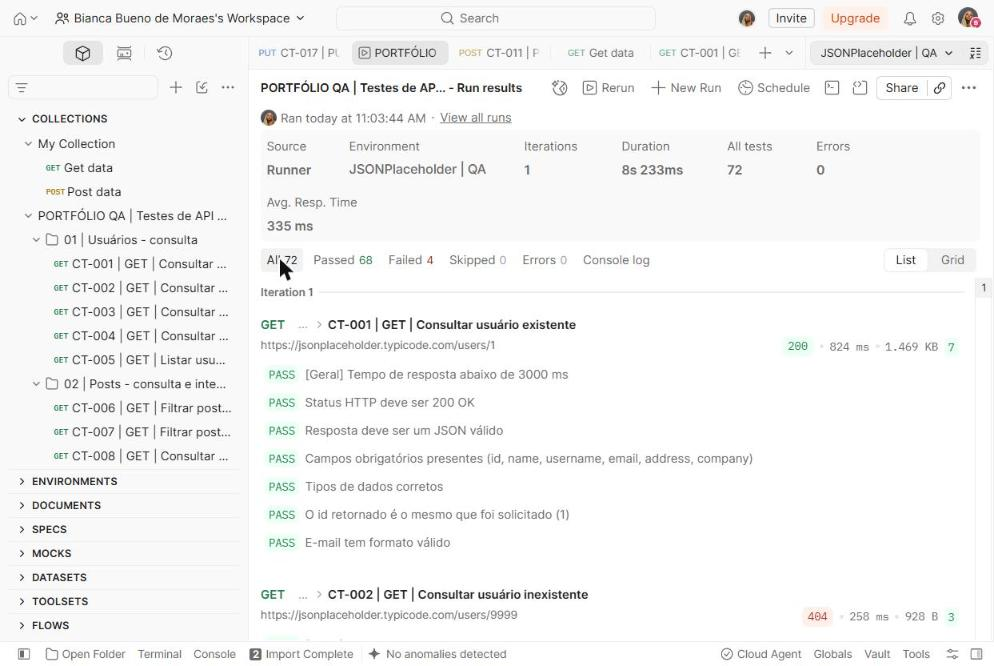
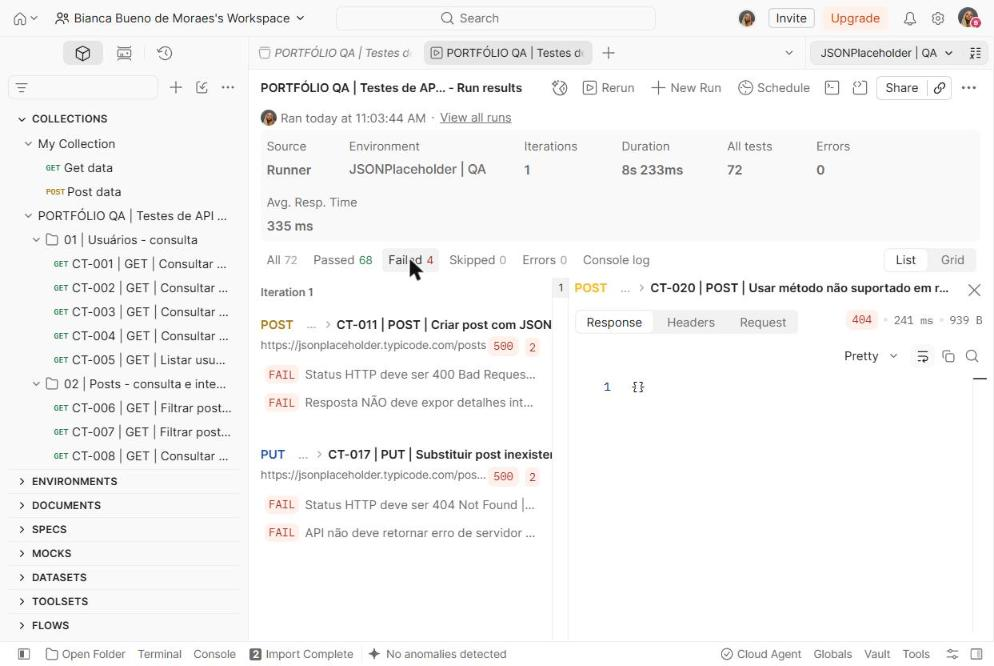
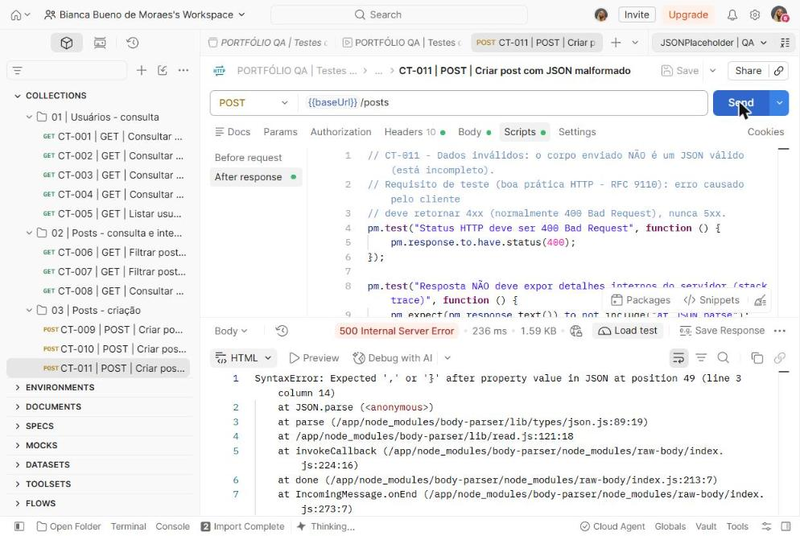
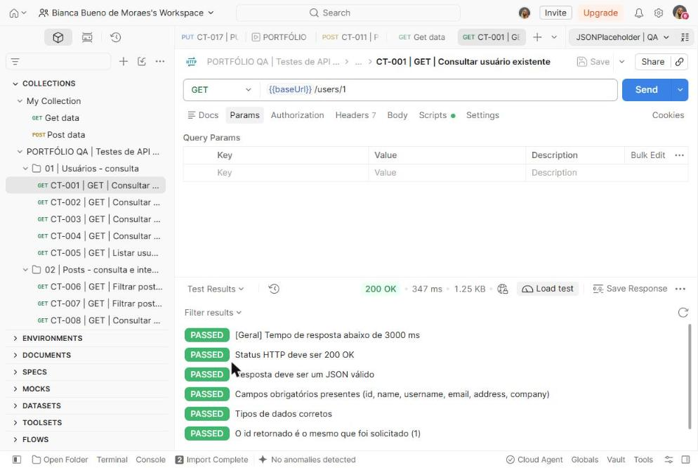

<div align="center">

# QA · API Testing with Postman

**Projeto prático de estudos e portfólio profissional** · Bianca Bueno de Moraes · QA Júnior em formação

[](collections/qa-api-tests.postman_collection.json)
[](#8-exemplos-de-scripts-automatizados)
[](#9-resultados-reais-das-execuções)
[](#11-bugs-identificados)

**[▶ Ver o portfólio visual](https://bbmoraes.github.io/qa-api-testing-postman/portfolio/)**

</div>

> Este é um **projeto de estudos**, não uma experiência profissional. Os testes foram executados de verdade no Postman, em 15/10/2026, e todos os números abaixo vêm dessa execução. As capturas de tela estão em [`evidence/screenshots`](evidence/screenshots).

## Sumário

1. [Apresentação](#1-apresentação) · 2. [Objetivo](#2-objetivo-dos-testes) · 3. [API utilizada](#3-api-utilizada) · 4. [Ferramentas](#4-ferramentas-e-tecnologias) · 5. [Escopo](#5-escopo-dos-testes) · 6. [Cenários](#6-cenários-positivos-negativos-de-limite-e-integração) · 7. [Estrutura](#7-estrutura-do-repositório) · 8. [Scripts](#8-exemplos-de-scripts-automatizados) · 9. [Resultados](#9-resultados-reais-das-execuções) · 10. [Evidências](#10-evidências) · 11. [Bugs](#11-bugs-identificados) · 12. [Como executar](#12-como-importar-e-executar-no-postman) · 13. [Aprendizados](#13-aprendizados) · 14. [Melhorias futuras](#14-melhorias-futuras)

## 1. Apresentação

Estou em transição de carreira de Social Media e Operações Digitais para Quality Assurance. No trabalho com conteúdo, eu já cuidava de briefings, prazos, revisão de entregas antes da publicação e relatórios de métricas. Neste projeto, apliquei esses hábitos a software: planejei, automatizei, executei e documentei uma bateria de testes funcionais para uma API REST pública.

## 2. Objetivo dos testes

Verificar se a API responde com o **status HTTP correto**, devolve um **JSON com a estrutura e os tipos esperados**, **trata erros** de forma adequada e mantém **consistência entre requisições encadeadas**. Também queria separar com clareza o que é defeito, o que é limitação conhecida e o que ainda depende de definição.

## 3. API utilizada

| Item | Detalhe |
|---|---|
| Sistema | [JSONPlaceholder](https://jsonplaceholder.typicode.com), API REST pública e gratuita de demonstração |
| Autenticação | Não exige |
| Recursos testados | `/users`, `/posts`, `/posts/{id}/comments` |
| Limitações documentadas | Criação, alteração e exclusão são **simuladas** (nada é persistido), e a API **não valida** o corpo das requisições |

Escolhi essa API por ser gratuita, estável e documentada, e por permitir testar os cinco métodos HTTP sem dados reais.

## 4. Ferramentas e tecnologias

| Ferramenta | Uso no projeto |
|---|---|
| Postman (web) | Criação das requisições, ambiente e variáveis |
| Collection Runner | Execução da collection completa, em ordem |
| JavaScript (`pm.test`, Chai) | Verificações automáticas em *Scripts › Post-response* e geração de dados em *Pre-request* |
| Variáveis de collection | Encadeamento de requisições (integração) |
| Markdown, CSV e XLSX | Documentação, casos de teste e relatórios |

## 5. Escopo dos testes

- **Dentro do escopo:** testes funcionais de GET, POST, PUT, PATCH e DELETE; validação de status, contrato JSON, tipos, valores, mensagens de erro, consistência entre requisições e tempo de resposta (limite de 3.000 ms).
- **Fora do escopo:** carga e desempenho, segurança aprofundada, autenticação e testes de interface.

**Critério de aprovação:** um caso só é *Aprovado* quando **todas** as suas verificações passam. Uma resposta 4xx **não** é falha quando é o resultado esperado de um cenário negativo.

**Requisito para erros:** como a API não documenta um contrato de erros, usei a semântica HTTP da RFC 9110 como requisito: erro causado pelo cliente deve gerar 4xx, e nenhuma resposta deve expor detalhes internos do servidor.

## 6. Cenários positivos, negativos, de limite e integração

| Tipo | O que foi testado | Casos |
|---|---|---|
| ✅ Positivo | Consulta, criação, substituição (PUT), atualização parcial (PATCH) e exclusão válidas | CT-001, 009, 015, 016, 018, 021 |
| ❌ Negativo | Id inexistente, id não numérico, filtro sem resultado, corpo vazio, JSON malformado, PUT e DELETE em recurso inexistente, método não suportado | CT-002, 003, 007, 010, 011, 017, 019, 020 |
| 📏 Limite | Id 0 (abaixo do intervalo 1–10), parâmetro desconhecido, campos vazios, título com 5.000 caracteres | CT-004, 005, 012, 013 |
| 🔗 Integração | O `userId` do CT-001 alimenta o CT-006, que alimenta o CT-008; o id criado no CT-009 é consultado no CT-014 | CT-006, 008, 014 |

A tabela completa, com objetivo, pré-condição, entrada, resultado esperado e obtido de cada caso, está em [`test-cases/test-cases.csv`](test-cases/test-cases.csv) (também em [`.xlsx`](test-cases/test-cases.xlsx)).

## 7. Estrutura do repositório

```
qa-api-testing-postman/
├── README.md
├── collections/
│   └── qa-api-tests.postman_collection.json   # 21 requisições + scripts comentados
├── environments/
│   └── public-test-environment.json           # só baseUrl e maxResponseTime (sem segredos)
├── test-cases/
│   ├── test-cases.csv
│   └── test-cases.xlsx                         # com aba de resumo
├── bug-reports/
│   └── README.md                               # defeitos reais + exemplo didático (simulação)
├── reports/
│   └── test-execution-report.md
├── evidence/
│   └── screenshots/                            # 13 capturas de tela do Postman
├── portfolio/
│   └── index.html                              # versão visual (GitHub Pages)
└── .gitignore
```

## 8. Exemplos de scripts automatizados

**Verificação aplicada a todas as requisições** (script no nível da collection):

```javascript
const limite = Number(pm.environment.get("maxResponseTime") || 3000);

pm.test("[Geral] Tempo de resposta abaixo de " + limite + " ms", function () {
    pm.expect(pm.response.responseTime).to.be.below(limite);
});
```

**Contrato e tipos de dados**, no CT-001:

```javascript
const usuario = pm.response.json();

pm.test("Campos obrigatórios presentes (id, name, username, email, address, company)", function () {
    pm.expect(usuario).to.include.all.keys("id", "name", "username", "email", "address", "company");
});

pm.test("Tipos de dados corretos", function () {
    pm.expect(usuario.id).to.be.a("number");
    pm.expect(usuario.address).to.be.an("object");
});

// Guarda o id para o próximo teste (integração)
pm.collectionVariables.set("userId", usuario.id);
```

**Integração entre requisições**, no CT-006:

```javascript
const userIdEsperado = Number(pm.collectionVariables.get("userId"));
const posts = pm.response.json();

pm.test("Consistência: TODOS os posts pertencem ao usuário filtrado", function () {
    pm.expect(posts.every(p => p.userId === userIdEsperado)).to.be.true;
});
```

**Cenário negativo com requisito explícito**, no CT-011:

```javascript
pm.test("Status HTTP deve ser 400 Bad Request", function () {
    pm.response.to.have.status(400);
});

pm.test("Resposta NÃO deve expor detalhes internos do servidor (stack trace)", function () {
    pm.expect(pm.response.text()).to.not.include("at JSON.parse");
});
```

Todos os scripts estão comentados em português dentro da [collection](collections/qa-api-tests.postman_collection.json).

## 9. Resultados reais das execuções

Execução de referência: **Collection Runner, 15/10/2026, 11:03:44 (horário de Brasília)**, ambiente `JSONPlaceholder | QA`, 1 iteração, duração de 8s 233ms e tempo médio de resposta de 335 ms.

| Casos de teste | Quantidade | | Verificações (`pm.test`) | Quantidade |
|---|---|---|---|---|
| Planejados | 21 | | Executadas | 72 |
| Executados | 21 | | Aprovadas | 68 |
| Aprovados | 19 | | Reprovadas | 4 |
| Reprovados | 2 | | Ignoradas | 0 |
| Bloqueados / não executados | 0 / 0 | | Erros de script | 0 |

**Taxa de aprovação dos casos = aprovados ÷ executados = 19 ÷ 21 = 90,5%** (denominador: os 21 casos executados).

As 72 verificações são as 51 escritas nas requisições mais 21 verificações de tempo de resposta (uma por requisição, vindas do script da collection).

| ID | Cenário | Status | Verif. | Situação |
|---|---|---|---|---|
| CT-001 | GET · Consultar usuário existente | 200 | 7/7 | ✅ Aprovado |
| CT-002 | GET · Consultar usuário inexistente | 404 | 3/3 | ✅ Aprovado |
| CT-003 | GET · Consultar usuário com ID não numérico | 404 | 3/3 | ✅ Aprovado |
| CT-004 | GET · Consultar usuário com ID zero (limite inferior) | 404 | 2/2 | ✅ Aprovado |
| CT-005 | GET · Listar usuários com parâmetro inesperado | 200 | 4/4 | ✅ Aprovado |
| CT-006 | GET · Filtrar posts pelo usuário retornado no CT-001 | 200 | 5/5 | ✅ Aprovado |
| CT-007 | GET · Filtrar posts por usuário inexistente | 200 | 3/3 | ✅ Aprovado |
| CT-008 | GET · Consultar comentários de um post existente | 200 | 4/4 | ✅ Aprovado |
| CT-009 | POST · Criar post com dados válidos | 201 | 4/4 | ✅ Aprovado |
| CT-010 | POST · Criar post sem campos obrigatórios | 201 | 3/3 | ✅ Aprovado (limitação) |
| CT-011 | POST · Criar post com JSON malformado | **500** | **1/3** | ❌ Reprovado → BUG-001 |
| CT-012 | POST · Criar post com campos vazios (limite) | 201 | 3/3 | ✅ Aprovado (limitação) |
| CT-013 | POST · Criar post com título de 5.000 caracteres | 201 | 3/3 | ✅ Aprovado |
| CT-014 | GET · Consultar post recém-criado (persistência) | 404 | 3/3 | ✅ Aprovado (comprova a limitação) |
| CT-015 | PUT · Substituir post existente | 200 | 3/3 | ✅ Aprovado |
| CT-016 | PATCH · Atualizar somente o título | 200 | 4/4 | ✅ Aprovado |
| CT-017 | PUT · Substituir post inexistente | **500** | **1/3** | ❌ Reprovado → BUG-002 |
| CT-018 | DELETE · Excluir post existente | 200 | 3/3 | ✅ Aprovado |
| CT-019 | DELETE · Excluir post inexistente | 200 | 3/3 | ✅ Aprovado (OBS-001) |
| CT-020 | POST · Usar método não suportado em recurso individual | 404 | 2/2 | ✅ Aprovado |
| CT-021 | POST · Cadastrar usuário válido (meu primeiro teste, reexecutado) | 201 | 4/4 | ✅ Aprovado |

Relatório completo: [`reports/test-execution-report.md`](reports/test-execution-report.md).

## 10. Evidências

| Resumo do Runner (72 verificações, 68 aprovadas) | Falhas isoladas pelo filtro |
|---|---|
|  |  |
| **BUG-001:** CT-011 retorna 500 com stack trace | **CT-001:** execução individual, aba Test Results |
|  |  |

As demais capturas (estrutura da collection, configuração do Runner, visão em grade e BUG-002) estão em [`evidence/screenshots`](evidence/screenshots), descritas na seção 6 do [relatório de execução](reports/test-execution-report.md#6-evidências).

## 11. Bugs identificados

| ID | Resumo | Classificação | Severidade |
|---|---|---|---|
| BUG-001 | `POST /posts` com JSON malformado retorna **500** e expõe stack trace (esperado: 400) | Defeito confirmado | Média |
| BUG-002 | `PUT /posts/9999` retorna **500** e expõe stack trace (esperado: 404) | Defeito confirmado | Média |
| OBS-001 | `DELETE /posts/9999` retorna 200 | Possível defeito, não confirmado | Baixa |
| LIM-001/002 | Sem persistência e sem validação de entrada | Limitação documentada (não é defeito) | — |

Os dois defeitos foram reproduzidos no Runner e em execução individual. Os scripts foram revisados e **não foram alterados para "passar"**. Detalhes, passos para reproduzir e um exemplo didático (marcado como simulação) estão em [`bug-reports/README.md`](bug-reports/README.md).

## 12. Como importar e executar no Postman

1. Baixe [`collections/qa-api-tests.postman_collection.json`](collections/qa-api-tests.postman_collection.json) e [`environments/public-test-environment.json`](environments/public-test-environment.json).
2. No Postman, clique em **Import** e selecione os dois arquivos.
3. No seletor de ambiente (canto superior direito), escolha **`JSONPlaceholder | QA`**.
4. Abra a collection **PORTFÓLIO QA | Testes de API REST** → **Run** → mantenha a ordem padrão → **Start run**.

Pela linha de comando, com [Newman](https://www.npmjs.com/package/newman):

```bash
npm install -g newman
newman run collections/qa-api-tests.postman_collection.json \
  -e environments/public-test-environment.json
```

> Os casos dependem da ordem de execução (CT-001 → CT-006 → CT-008 e CT-009 → CT-014). Enquanto o comportamento da API não mudar, o CT-011 e o CT-017 continuam reprovando. Os tempos de resposta variam a cada execução.

## 13. Aprendizados

- **Um 4xx pode ser o resultado certo.** O que define a aprovação é o resultado esperado, e não a cor do status.
- **Classificar antes de reportar.** Defeito, limitação documentada e comportamento indefinido pedem respostas diferentes: dos 4 comportamentos estranhos, só 2 viraram bug.
- **Investigar o próprio teste primeiro.** Reproduzi as falhas isoladamente e recusei a sugestão automática do Postman de ajustar a asserção, porque isso esconderia o defeito.
- **Encadear requisições revela inconsistências** que testes isolados não mostram.
- **Documentação faz parte do teste.** Casos, evidências e relatório permitem que outra pessoa refaça tudo e chegue ao mesmo resultado.

## 14. Melhorias futuras

- [ ] Rodar a collection com Newman em um workflow do **GitHub Actions** a cada push, com relatório HTML (`newman-reporter-htmlextra`).
- [ ] *Data-driven testing* com arquivo CSV de ids e payloads.
- [ ] Validação de schema com `pm.response.to.have.jsonSchema`.
- [ ] Testar uma API com autenticação por token (por exemplo, Restful-Booker).
- [ ] Levar parte dos cenários para código, com Playwright API testing.

---

<sub>Sistema testado: JSONPlaceholder, um serviço público de terceiros usado apenas para aprendizado. Nenhum dado pessoal, credencial ou sistema de produção foi utilizado.</sub>
